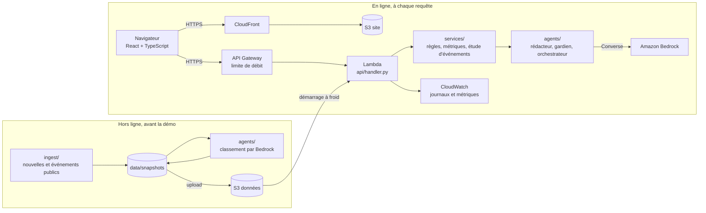

# AlphaAI

**Le second avis dont chaque investisseur a besoin.** Avant de réagir à une nouvelle ou d'acheter un titre à la mode,
AlphaAI te dit si ça compte vraiment pour toi, et te montre exactement pourquoi.

Projet du défi AlphaForge AI (PolyFinances Datathon 2026 × Banque Nationale × AWS) :

- un **profil d'investisseur** calculé par des règles écrites, à partir d'un court questionnaire ou d'un profil d'exemple ;
- un **fil de nouvelles trié pour ton portefeuille**, avec la raison de chaque nouvelle retenue ou écartée ;
- un **test d'achat** (« j'envisage d'acheter X ») jugé cohérent, en tension ou incohérent avec ton profil ;
- des **explications vérifiables** : chaque chiffre vient d'une preuve calculée par le code, et un gardien vérifie
  chaque phrase écrite par le modèle.

Site en ligne : <https://dwaeuacpobjns.cloudfront.net>

## Structure du dépôt

| Dossier | Contenu |
| --- | --- |
| `core/` | Données, portefeuille, métriques, étude d'événements, qualité des données, moteur de règles (code pur, sans réseau) |
| `agents/` | Classifieur, rédacteur d'explications, gardien, orchestrateur à outils, gouvernance (Amazon Bedrock) ; `prompts/` versionnés |
| `services/` | Façade appelée par l'API (`build_feed`, `score_profile`, `parse_portfolio`…) |
| `api/` | Lambda (`handler.py`) et serveur local FastAPI (`local_server.py`) |
| `web/` | Interface React + TypeScript (Vite) |
| `rules/` | Règles financières en YAML : questionnaire, profils, taxonomie, pertinence, cohérence, personas |
| `contracts/` | JSON Schemas des échanges API et des fichiers de règles, avec exemples |
| `data/` | Jeu de départ (prix, dividendes, change, taux) et `snapshots/` (nouvelles, événements, classement) |
| `ingest/` | Récupération des nouvelles, des événements et des prix à la demande |
| `infra/`, `scripts/` | Infrastructure AWS (SAM) et scripts de déploiement et de test de fumée |
| `tests/`, `eval/` | Tests pytest ; jeu de titres étiquetés et rapports d'évaluation du classifieur |
| `docs/` | Documentation technique, one-pager, script vidéo, validation, limites, AWS |

## Architecture

Le code calcule les chiffres et applique les règles ; le modèle de langage (Amazon Bedrock) classe des titres et rédige à partir de preuves, sous le contrôle d'un gardien qui vérifie chaque phrase.



- **Règles d'abord, modèle ensuite.** Le profil, la pertinence et la cohérence viennent de règles YAML déterministes ; le modèle ne décide jamais du verdict.
- **Explications vérifiables.** Chaque chiffre vient d'une preuve calculée par le code, et le gardien rejette toute phrase qui n'est pas appuyée par une preuve.
- **Rien de lent sur le chemin en ligne.** L'ingestion et le classement se font avant la démo ; la Lambda ne lit que des snapshots.
- **Dégradation propre.** Si Bedrock est indisponible, le fil reste affiché (règles et preuves, sans résumé) plutôt que d'inventer une explication.
- **Même contrat en local et sur AWS.** Le serveur FastAPI local et la Lambda passent par les mêmes routes et la même validation.
- **Vie privée.** Aucun portefeuille ni profil n'est stocké ni journalisé ; buckets privés et rôle Lambda au moindre privilège.

Détails complets : [docs/architecture.md](docs/architecture.md).

## Prérequis

- Python 3.11 ou plus
- Node.js 22 et npm
- Pour le déploiement seulement : AWS CLI v2 et des identifiants AWS

## Installation locale (environ 5 minutes, sans AWS)

En local, l'API tourne en mode `mock` : aucun appel à Bedrock, les explications sont rédigées à partir des règles et
des preuves.

**1. API**

```bash
python -m venv .venv
source .venv/bin/activate              # Windows : .venv\Scripts\activate
pip install -r requirements-dev.txt -r api/requirements-local.txt
python -m api.local_server             # http://127.0.0.1:8000  (équivaut à : make dev)
```

**2. Site web** (dans un second terminal)

```bash
cd web
npm install
npm run dev                            # http://localhost:5173
```

Le site appelle `http://127.0.0.1:8000` par défaut. Pour viser une autre API, copier `web/.env.example` en `web/.env`
et renseigner `VITE_API_URL`. Détails du front : [`web/README.md`](web/README.md).

**3. Essayer** : ouvrir <http://localhost:5173>, charger le profil de Robert, utiliser son portefeuille d'exemple,
puis ouvrir « Tester un achat » avec NVDA à 20 %.

### Sans `make` (Windows)

| Cible | Commande équivalente |
| --- | --- |
| `make dev` | `python -m api.local_server` |
| `make test` | `python -m tools.export_schemas --check` puis `python -m pytest -q tests api/tests` |
| `make validate-rules` | `python -m tools.validate_rules` |
| `make smoke-local` | `python scripts/smoke_test.py --base-url http://127.0.0.1:8000` |

## Tests

```bash
make test               # contrats à jour, tests du backend et de l'API (hors ligne)
make validate-rules     # fichiers de rules/ contre leurs schémas
cd web && npm test      # tests de l'interface (Vitest)
```

## Activer Bedrock en local (facultatif)

Copier `.env.example` en `.env` (jamais commité) et renseigner :

```bash
LLM_PROVIDER=bedrock
BEDROCK_MODEL_ID=us.anthropic.claude-sonnet-4-6
BEDROCK_REGION=us-east-1
```

Les identifiants AWS viennent de l'environnement (`AWS_ACCESS_KEY_ID`, `AWS_SECRET_ACCESS_KEY`, `AWS_SESSION_TOKEN`).
`make check-aws` vérifie l'accès au modèle.

## Données

- **Jeu de départ** (`data/`, du 2021-11-12 au 2026-11-12) : 31 actifs (actions canadiennes et américaines, FNB,
  bitcoin, ether), prix quotidiens et dividendes (Yahoo Finance via `yfinance`), taux de change USD/CAD et taux
  canadiens (API Valet de la Banque du Canada), taux et inflation américains (FRED). Sources, traitements et limites :
  [`data/README.md`](data/README.md) et `data/sources_metadata.csv`.
- **Snapshots** (`data/snapshots/`) : nouvelles publiques (titre, source, date, lien, extrait de 300 caractères au
  plus), événements (résultats, dividendes, décisions de taux) et classement des titres par Bedrock, figés pour que
  les résultats soient reproductibles. Rapport d'ingestion : `data/snapshots/REPORT_20261115.md`.
- **Rafraîchir les snapshots** (réseau requis) :

```bash
pip install -r requirements-ingest.txt
make ingest             # nouvelles et événements   (python -m ingest.run --google)
make classify           # classement des titres     (python -m agents.classify_batch, Bedrock requis)
```

Les titres hors des 31 actifs testés dans « Tester un achat » sont téléchargés à la demande, puis contrôlés avant
tout calcul.

## Déploiement AWS

Pas besoin de Docker ni de la SAM CLI. Identifiants AWS dans l'environnement (ou dans `.env`, jamais commité).

```bash
make check-aws      # audit du compte et test Bedrock          (python infra/scripts/check_bedrock.py)
make deploy         # Lambda, API, buckets, CloudFront, données (python scripts/deploy.py deploy)
make deploy-web     # build du site et invalidation du cache   (python scripts/deploy.py deploy-web)
make smoke          # test de fumée de l'API déployée          (python scripts/smoke_test.py --deployed)
make upload-data    # rafraîchir les snapshots sur S3, sans redéployer
make destroy        # tout retirer, après confirmation
```

Variables : `BEDROCK_MODEL_ID` (retenu : `us.anthropic.claude-sonnet-4-6`), `AWS_REGION` (`us-east-1`),
`STACK_NAME` (`alphaforge`), `BUDGET_EMAIL` (facultatif : alerte de coût). `make deploy-web` renseigne
`VITE_API_URL` à partir des sorties de la pile.

Services utilisés : Amazon Bedrock, AWS Lambda, Amazon API Gateway (HTTP API), Amazon S3, Amazon CloudFront,
Amazon CloudWatch. Rôle de chacun : [`docs/AWS.md`](docs/AWS.md) ; schéma : [`docs/architecture.md`](docs/architecture.md).

## Documentation

| Document | Contenu |
| --- | --- |
| [`docs/TECH_DOC.md`](docs/TECH_DOC.md) | Méthodes, sources, traitements, hypothèses, mécanisme d'explicabilité |
| [`docs/ONE_PAGER.md`](docs/ONE_PAGER.md) | Résumé du projet en une page |
| [`docs/VIDEO_SCRIPT.md`](docs/VIDEO_SCRIPT.md) | Script de la vidéo |
| [`docs/VALIDATION.md`](docs/VALIDATION.md) | Validation indépendante des chiffres affichés |
| [`docs/LIMITS.md`](docs/LIMITS.md) | Limites connues |
| [`docs/TEST_SCENARIOS.md`](docs/TEST_SCENARIOS.md) | Scénarios de test manuels |
| [`core/METRICS.md`](core/METRICS.md) | Définition des métriques |
| [`contracts/`](contracts/) | Contrats de l'API (JSON Schema) |
